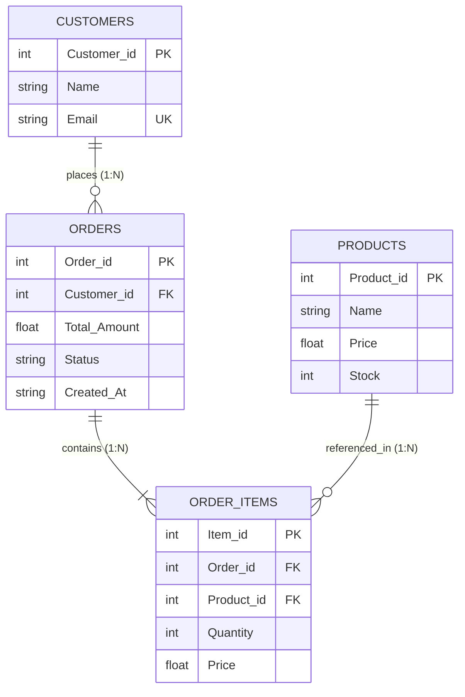

# Capstone Project Audit: E-Commerce Dispatch and Inventory Management

**Date:** October 25, 2026  
**Auditor:** Valour (Academic Reviewer & Systems Audit)  
**Project:** E-Commerce Dispatch & Inventory Management (Python / DSA / DBMS)  
**Target Platform:** Windows (PowerShell), Python 3.10+ compatible (tested on Python 3.13.7)  

---

> [!WARNING]
> **OneDrive Synchronization Alert**: The project repository is located at:  
> `C:\Users\shaik\OneDrive\Desktop\College (Rehan)\Capstone Project Final`  
> Microsoft OneDrive actively synchronizes files in this directory. SQLite databases (`ecommerce.db`, temporary journals, and WAL files) as well as `.git` repository index files are vulnerable to file-locking conflicts and silent corruption under real-time cloud sync. It is strongly advised to copy/work in a local non-synced directory (e.g. `C:\Projects\Capstone-Project`) for development and demonstrations, keeping OneDrive only for periodic external archives.

---

## 1. System Stack, Entry Points, and Folder Map

### Current Stack & Runtime
- **Runtime Environment:** Python 3.13.7 (64-bit AMD64 on Windows). Target compatibility floor: Python 3.10.
- **Database Engine:** SQLite 3 (single-file relational database `ecommerce.db`).
- **Dependencies:** Standard library only (`sqlite3`, `datetime`, `sys`, `os`, `shutil`). No external dependencies or virtual environment files currently exist.
- **Version Control:** Git is currently **not initialized** in this directory.

### Repository Map
```text
Capstone Project Final/
├── algorithm.py         # Merge sort (price) & Binary search (product ID)
├── data_structures.py   # CreateStack (cart), DispatchQueue (orders), OrderTracker (stages)
├── ecommerce.db         # SQLite3 database (active data: 1 customer, 3 products, 1 order)
├── init_db.py           # Standalone schema and seeding script
└── main.py              # CLI entry point and monolithic business logic
```

### Entry Points
| File | Invocation | Role / Intended Usage |
|---|---|---|
| `main.py` | `python main.py` | Interactive CLI menu (Options 1–9) connecting DB, DSA, and user input |
| `init_db.py` | `python init_db.py` | Standalone script to initialize tables and insert seed data |
| `algorithm.py` | `python algorithm.py` | Module providing algorithms; contains standalone test harness |
| `data_structures.py` | `python data_structures.py` | Module providing data structures; contains standalone test harness |

---

## 2. Function and Command Traceability Table

| CLI Option / Method | Implementation Function | Source File | Database Tables Touched | Operation |
|---|---|---|---|---|
| Startup Initialization | `ECommerceApp.__init__()` | `main.py:L7-20` | `PRAGMA foreign_keys` | Connection, foreign keys ON |
| Schema Verification | `ECommerceApp._ensure_schema()` | `main.py:L21-63` | `Customers`, `Products`, `Orders`, `Order_Items` | `CREATE TABLE IF NOT EXISTS`, `INSERT OR IGNORE` |
| Queue Sync | `ECommerceApp._sync_queue()` | `main.py:L65-71` | `Orders` | `SELECT order_id WHERE status != 'Delivered'` |
| Option 1: Browse Catalog | `algorithm.merge_sort_by_price()` | `algorithm.py:L1-35` | `Products` | `SELECT` via `app.get_products()` |
| Option 2: Search by ID | `algorithm.binary_search_by_id()` | `algorithm.py:L37-54` | `Products` | `SELECT` via `app.get_products()` |
| Option 3: Add to Cart | `ECommerceApp.add_to_cart()` | `main.py:L79-97` | `Products` | `SELECT` (stock check); pushes to `self.cart` |
| Option 4: Undo Cart Item | `ECommerceApp.undo_cart()` | `main.py:L99-104` | None | In-memory `self.cart.pop()` |
| Option 5: View Cart | CLI block in `main()` | `main.py:L259-267` | None | Traverses in-memory `self.cart.item` |
| Option 6: Checkout | `ECommerceApp.checkout()` | `main.py:L106-143` | `Orders`, `Order_Items`, `Products` | `INSERT INTO Orders`, `INSERT INTO Order_Items`, `UPDATE Products (stock)` |
| Option 7: Advance Dispatch | `ECommerceApp.advance_dispatch()` | `main.py:L144-175` | `Orders` | `SELECT status`, `UPDATE status`; modifies `self.dispatch_queue` |
| Option 8: Track Order | `ECommerceApp.track_order()` | `main.py:L176-204` | `Orders`, `Customers`, `Order_Items`, `Products` | `SELECT` with `INNER JOIN` |
| Option 9: Exit | CLI block in `main()` | `main.py:L294-297` | None | `conn.close()`, terminates loop |

---

## 3. Database Schema, Entity Relationship Diagram, and Schema Deficiencies

### Active Schema (Inspected on Copy of `ecommerce.db`)
```sql
CREATE TABLE Customers(
    Customer_id INTEGER PRIMARY KEY AUTOINCREMENT,
    Name TEXT NOT NULL,
    Email TEXT NOT NULL UNIQUE
);

CREATE TABLE Products(
    Product_id INTEGER PRIMARY KEY AUTOINCREMENT,
    Name TEXT NOT NULL,
    Price REAL NOT NULL CHECK(Price > 0),
    Stock INTEGER CHECK(Stock >= 0)
);

CREATE TABLE Orders(
    Order_id INTEGER PRIMARY KEY AUTOINCREMENT,
    Customer_id INTEGER NOT NULL,
    Total_Amount REAL NOT NULL,
    Status TEXT NOT NULL CHECK(Status IN('Placed','Payment Confirmed','Packed','Dispatched','Delivered','Cancelled')),
    Created_At TEXT NOT NULL DEFAULT(DATETIME('now')),
    FOREIGN KEY(Customer_id) REFERENCES Customers(Customer_id) ON DELETE CASCADE
);

CREATE TABLE Order_Items(
    Item_id INTEGER PRIMARY KEY AUTOINCREMENT,
    Order_id INTEGER NOT NULL,
    Product_id INTEGER NOT NULL,
    Quantity INTEGER NOT NULL CHECK(Quantity > 0),
    Price REAL NOT NULL CHECK(Price > 0),
    FOREIGN KEY(Order_id) REFERENCES Orders(Order_id) ON DELETE CASCADE,
    FOREIGN KEY(Product_id) REFERENCES Products(Product_id) ON DELETE CASCADE
);
```

### Entity Relationship Diagram


### Current Data Content in `ecommerce.db`
- **`Customers` (1 row):** `(1, 'Anant Shrivastav', '125anant6027@sjcem.edu.in')`
- **`Products` (3 rows):**
  - `(1, 'Laptop', 999.99, 5)` (Initial stock was 10, reduced to 5 after Order 1)
  - `(2, 'Mouse', 29.99, 50)`
  - `(3, 'Keyboard', 79.99, 30)`
- **`Orders` (1 row):** `(1, 1, 4999.95, 'Packed', '2026-08-16 18:37:13')`
- **`Order_Items` (1 row):** `(1, 1, 1, 5, 999.99)`

### Schema Flaws & Vulnerabilities
1. **Financial Float Inaccuracy:** `Price` and `Total_Amount` use `REAL` (IEEE 754 floating point). Binary floating-point cannot represent decimal fractions precisely (e.g. `0.1 + 0.2 = 0.30000000000000004`).
2. **Missing Authentication Credentials:** `Customers` table lacks password storage (`password_hash`), salt, and registration timestamps.
3. **No Role-Based Authorization:** No `role` attribute (e.g. `customer` vs `admin`/`warehouse_staff`).
4. **Missing Foreign Key Indexes:** SQLite does not automatically index foreign keys. Lookups on `Orders(Customer_id)`, `Order_Items(Order_id)`, and `Order_Items(Product_id)` require full table scans during JOINs and cascade operations.
5. **No Soft Deletes or Order Cancellation Reason:** No timestamp for dispatch or cancellation.

---

## 4. Feature Verification Matrix

| Feature | Status | Verification Method | Observations |
|---|---|---|---|
| Browse Catalog | **Works** | Verified by running | Sorts correctly by price ascending using merge sort. Ascending order only. |
| Search by Product ID | **Works** | Verified by running | Binary search finds item in $O(\log n)$, but Python re-sorts list in $O(n \log n)$ before every search. |
| Add to Cart | **Broken** | Verified by running | Does not check cumulative quantity in cart against stock. Allows cart count to exceed physical stock. |
| Undo Cart Item | **Works** | Verified by running | Pops last pushed item from stack correctly. |
| View Cart | **Works** | Verified by running | Displays stack in reverse order (top first). |
| Checkout | **Partly Broken** | Verified by running | Rolls back on stock deficit, but hardcoded to Customer ID 1. No customer selection. |
| Advance Dispatch | **Broken by Design** | Verified by running | Order at head of queue is never dequeued until `Delivered`. Subsequent orders starve. |
| Track Order | **Works** | Verified by running | Performs SQL join and displays line items. |
| Cancel Order | **Missing** | Verified in code | No cancel operation implemented. Stock restoration does not exist. |
| Search by Name | **Missing** | Verified in code | Only search by ID exists. |
| Customer Login/Register | **Missing** | Verified in code | No authentication mechanism exists. |
| Web Application | **Missing** | Verified in file system | No web templates, static files, or web server exist. |

---

## 5. DSA Usage & Unused Code Audit

### Module: `algorithm.py`
- `merge_sort_by_price(products)`: **Active** — Called in `main.py:L227`. Time complexity: $O(n \log n)$, Space complexity: $O(n)$.
- `_merge(left, right)`: **Active** — Private helper for `merge_sort_by_price`.
- `binary_search_by_id(sorted_products, target_id)`: **Active** — Called in `main.py:L84` and `main.py:L238`. Time complexity: $O(\log n)$, Space complexity: $O(1)$.

### Module: `data_structures.py`
- `CreateStack`:
  - `push(product)`: **Active** — `main.py:L91` (`add_to_cart`). Time: $O(1)$.
  - `pop()`: **Active** — `main.py:L101` (`undo_cart`). Time: $O(1)$.
  - `peek()`: **Unused in main.py** — Implemented but never called.
  - `is_empty()`: **Active** — `main.py:L108, L260`. Time: $O(1)$.
  - `get_total_price()`: **Active** — `main.py:L112, L266`. Time: $O(k)$ where $k$ is cart size.
  - `clear()`: **Active** — `main.py:L137`.
- `DispatchQueue`:
  - `enqueue(order_id)`: **Active** — `main.py:L71, L136`. Time: $O(1)$ amortized append.
  - `dequeue()`: **Active** — `main.py:L154, L168, L173`. Time: $O(n)$ due to `list.pop(0)`.
  - `peek()`: **Active** — `main.py:L149`. Time: $O(1)$.
  - `is_empty()`: **Active** — `main.py:L146`. Time: $O(1)$.
  - `size()`: **Unused in main.py** — Implemented but never called in application flow.
- `StatusNode` & `OrderTracker` (Singly Linked List):
  - `OrderTracker.__init__()`: **Active** — Builds linked list `Placed -> Payment Confirmed -> Packed -> Dispatched -> Delivered`.
  - `OrderTracker.get_next_stage(current_stage)`: **Active** — Linearly scans nodes to find current stage and returns `next.stage_name`.
  - **Limitation:** The linked list nodes are not exposed for traversal or UI rendering; only the next stage name string is retrieved.

---

## 6. SQLite Integrity & Health Checks (Executed on Database Copy)

1. `PRAGMA foreign_keys;`: Enabled (`1`). Enforces referential integrity.
2. `PRAGMA integrity_check;`: Returned `ok`. No page corruption, freelist defects, or B-tree inconsistencies.
3. `PRAGMA foreign_key_check;`: Returned empty (`[]`). Zero orphaned rows exist.
4. **Connection Handling in `main.py`:**
   - Single persistent `self.conn = sqlite3.connect(db_name)` created in `__init__`.
   - In a multi-threaded web server (such as Flask), sharing a single SQLite connection across threads will raise `sqlite3.ProgrammingError: SQLite objects created in a thread can only be used in that same thread`. Flask requires request-scoped connections (`g.db`).

---

## 7. Verification of the 14 Known External Review Issues

| # | Issue Description | Verified Status | File & Line | Evidence & Academic Analysis |
|---|---|---|---|---|
| **1** | `get_total_price()` reads lowercase `'price'`/`'quantity'`, but `__main__` passes `"Price"`/`"Quantity"`. | **CONFIRMED** | `data_structures.py:L86-88` vs `L25` | Running `python data_structures.py` immediately raises `KeyError: 'price'`. `line 25` expects lowercase keys. |
| **2** | `init_db.py` f-string uses nested double quotes inside double quotes (breaks on Python < 3.12). | **CONFIRMED** | `init_db.py:L72` | `print(f"{"ID":<4}{"Name":<30} ...")` raises `SyntaxError` on Python 3.10 and 3.11. Python 3.12+ generalized f-string quoting, but older lab runtimes will crash. |
| **3** | `init_db.py` seeds 10 products, but `main.py._ensure_schema()` seeds only 3 products. | **CONFIRMED** | `init_db.py:L45-56` vs `main.py:L60-62` | Starting via `main.py` creates a 3-product DB; running `init_db.py` creates a 10-product DB. Schema creation must be unified into a single canonical module. |
| **4** | Dispatch queue starvation: `advance_dispatch()` peeks at head, only dequeues on `Delivered`. | **CONFIRMED** | `main.py:L149-174` | Verified experimentally: Head order stays at index 0 across 4 stages. All subsequent orders wait until Order 1 is delivered. |
| **5** | `_sync_queue()` selects `status != 'Delivered'`, loading `Cancelled` orders into the queue. | **CONFIRMED** | `main.py:L68` | `Cancelled` orders satisfy `status != 'Delivered'` and are queued for warehouse dispatch. Must be `WHERE status NOT IN ('Delivered', 'Cancelled')`. |
| **6** | `DispatchQueue.dequeue()` uses `list.pop(0)`, which is $O(n)$. | **CONFIRMED** | `data_structures.py:L41` | Python list `pop(0)` shifts all $n-1$ remaining items in contiguous memory. True queue requires $O(1)$. |
| **7** | Binary search re-sorts list on every search ($O(n \log n)$), erasing algorithm benefits. | **CONFIRMED** | `main.py:L83, L235` | Sorting in $O(n \log n)$ prior to binary search in $O(\log n)$ yields worse overall complexity than linear search ($O(n)$). Catalog should be pre-sorted or queried via SQL index. |
| **8** | Cart stock check ignores existing cart quantities, triggering DB constraint error at checkout. | **CONFIRMED** | `main.py:L88-97` vs `L128-132` | Adding 4 units of Laptop twice (stock 5) succeeds in cart, then crashes checkout with SQLite `CHECK constraint failed: Stock>=0`. |
| **9** | No order cancellation exists. | **CONFIRMED** | `main.py` | No method exists to transition orders to `Cancelled`, remove them from the dispatch queue, or restock inventory. |
| **10** | `checkout()` hardcoded to `customer_id=1`. | **CONFIRMED** | `main.py:L106, L269` | Hardcoded customer ID. No user authentication or registration flow exists. |
| **11** | Search exists only by numeric ID. | **CONFIRMED** | `main.py:L233-245` | Real users search by name. Python substring linear search should be implemented in `algorithm.py`. |
| **12** | Order stage "Payment Confirmed" misleads users since no payment gateway exists. | **CONFIRMED** | `data_structures.py:L66`, schema | Pretends external payment processing occurs. Honest terminology (e.g. "Order Confirmed" or "Payment Recorded") is needed. |
| **13** | Currency/Price stored as floating point (`REAL`). | **CONFIRMED** | `init_db.py:L16`, `main.py:L33` | Database uses `REAL`. Rounding inaccuracies will compound over financial transactions. |
| **14** | `PRAGMA foreign_keys = ON` on every connection. | **PARTLY TRUE** | `main.py:L10`, `init_db.py:L4` | Present on existing CLI connections, but connection lifecycle must be standardized for web requests to ensure foreign keys are never omitted. |

---

## 8. Additional Backend, Concurrency, and Security Vulnerabilities

1. **Thread-Safety & Web Concurrency:**  
   `main.py` opens one SQLite connection and holds it globally. SQLite connections in Python cannot be safely shared across concurrent HTTP request threads.
2. **Plaintext Passwords & Auth Absence:**  
   There are currently no password hashes, salts, or sessions. Anyone using the application is automatically Customer 1.
3. **Transaction Rollback Exception Handling:**  
   In `checkout()`, `except Exception as e:` catches broad exceptions without distinguishing between integrity errors, locking errors, or data type faults.
4. **Currency Inconsistency in UI:**  
   `main.py` and `data_structures.py` display `Rs` (Rupees), while `init_db.py` uses USD-style decimal product prices (e.g., $999.99 for a laptop, which in INR would be extremely cheap). Currency formatting must be uniform and explicit.

---

## 9. Content Gaps Audit

1. **Product Photography / Images:**  
   Zero image files exist in the repository. The `Products` table has no image path column. In accordance with project instructions, we will not use generic stock photos. Instead, a clean, intentional typographic product presentation will be designed, with a nullable `image_url` column added for future use.
2. **Missing Product Details:**  
   Products only possess `Name`, `Price`, and `Stock`. Crucial attributes like `Category`, `Description`, and `SKU` are absent.
3. **Seed Catalog Discrepancy:**  
   `init_db.py` specifies 10 products (Laptop, Mouse, Keyboard, Monitor, Printer, Webcam, Headphones, Speakers, External Hard Drive, USB Flash Drive), but `ecommerce.db` currently only contains the first 3 products.
4. **Customer Profile Information:**  
   `Customers` only contains `Name` and `Email`. Address and contact phone numbers do not exist in the database.

---

## 10. Audit Summary for Academic Viva Defence

The existing project provides a solid educational foundation demonstrating the integration of SQLite with fundamental computer science data structures (Stack, Queue, Linked List) and algorithms (Merge Sort, Binary Search). However, it suffers from critical concurrency, validation, and design flaws:
- The queue starvation bug in `advance_dispatch()` invalidates the fairness property of FIFO queues.
- The cart lacks cumulative stock aggregation.
- The dispatch queue includes cancelled orders.
- The database connection pattern is strictly single-threaded.

Addressing these issues through a shared service layer, transactional migrations, and an accessible, bespoke Flask web interface will elevate the project to a robust, viva-defensible capstone submission.
